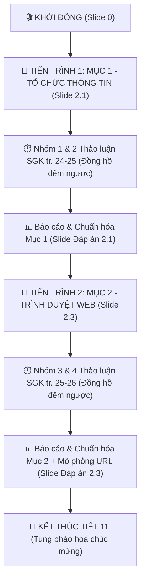

# KẾ HOẠCH BÀI DẠY (TRÍCH ĐOẠN HOẠT ĐỘNG 2: HÌNH THÀNH KIẾN THỨC)
## MÔN TIN HỌC 6 – BÀI 6: MẠNG THÔNG TIN TOÀN CẦU (TIẾT 11)
**Bộ sách:** Kết nối tri thức với cuộc sống  
**Thời lượng Tiết 11:** 45 phút (Gồm Khởi động và Hoạt động 2: Hình thành kiến thức mới)  
*(Lưu ý: Hoạt động 3 Luyện tập và Hoạt động 4 Vận dụng được bố trí sang Tiết 12 theo Kế hoạch dạy học)*  
**Giáo viên thực hiện:** Thầy Trần Đức Tình – Trường THCS Đắk Trôi  

---

## I. MỤC TIÊU CỦA HOẠT ĐỘNG HÌNH THÀNH KIẾN THỨC

### 1. Về kiến thức:
* Nêu được thông tin trên Internet được tổ chức dưới dạng các **trang web** liên kết với nhau bởi các **siêu liên kết**.
* Nêu được các khái niệm: **siêu văn bản (hypertext)**, **siêu liên kết (hyperlink)**, **website**, **trang chủ (homepage)**, **địa chỉ website** và **mạng thông tin toàn cầu (World Wide Web - WWW)**.
* Nêu được khái niệm và chức năng của **trình duyệt web (web browser)**. Kể tên một số trình duyệt phổ biến (*Google Chrome, Cốc Cốc, Microsoft Edge, Safari, Firefox*).
* Trình bày được **quy trình chuẩn 3 bước truy cập một trang web** và xác định chính xác **vị trí thanh địa chỉ (Address Bar)** trên cửa sổ trình duyệt.

### 2. Về năng lực:
* **Năng lực tự chủ và tự học:** Tự lực đọc SGK Tin học 6 (trang 24 - 26), tư duy và hợp tác nhóm giải quyết câu hỏi phiếu học tập.
* **Năng lực giao tiếp và hợp tác:** Làm việc nhóm phân vai (nhóm trưởng điều hành, thư ký ghi chép, đại diện báo cáo), tích cực thảo luận, nhận xét và phản biện kết quả giữa các nhóm.
* **Năng lực ứng dụng CNTT và truyền thông (NLa):** Nhận biết được giao diện trình duyệt, thanh địa chỉ và biết cách thao tác truy cập địa chỉ website phục vụ học tập.

### 3. Về phẩm chất:
* **Chăm chỉ:** Chủ động tìm hiểu tài liệu, tích cực tham gia hoạt động nhóm.
* **Trách nhiệm:** Hoàn thành nhiệm vụ nhóm được giao, giữ gìn trật tự và kỷ luật lớp học.

---

## II. THIẾT BỊ DẠY HỌC VÀ HỌC LIỆU SỐ TRÌNH CHIẾU

* **Thiết bị:** Máy tính giáo viên, máy chiếu / màn hình tương tác, hệ thống loa lớp học, bảng nhóm / giấy A3 / bút dạ.
* **Học liệu số khớp 100% với bài dạy:** Hệ thống slide bài giảng tương tác Bài 6 gồm 5 slide cốt lõi:
  * **Slide 0:** Bìa bài học & Khởi động.
  * **Slide 1 (`2.1`):** Giao việc Mục 1 (Nhóm 1 & 2) + Đồng hồ đếm ngược tương tác 5 - 8 phút.
  * **Slide 2 (`Đáp án 2.1`):** Báo cáo & Bảng chuẩn hóa kiến thức Mục 1 (Hiện/Ẩn đáp án từng câu).
  * **Slide 3 (`2.3`):** Giao việc Mục 2 (Nhóm 3 & 4) + Đồng hồ đếm ngược tương tác 5 - 8 phút.
  * **Slide 4 (`Đáp án 2.3`):** Báo cáo & Bảng chuẩn hóa Mục 2 + Bộ giả lập gõ thanh địa chỉ Address Bar tương tác + Nút hoàn thành tiết dạy.

---

## III. TIẾN TRÌNH DẠY HỌC CHI TIẾT (CHUẨN CÔNG VĂN 5512)



---

### HOẠT ĐỘNG 2: HÌNH THÀNH KIẾN THỨC MỚI (Thời lượng: ~30 - 32 phút)

---

#### 1. TIẾN TRÌNH 1: TÌM HIỂU MỤC 1 – TỔ CHỨC THÔNG TIN TRÊN INTERNET
*(Tương ứng với Slide 1 `2.1` và Slide 2 `Đáp án 2.1` trên màn hình trình chiếu)*

##### a) Mục tiêu:
* Học sinh nêu được cách tổ chức thông tin trên Internet qua trang web, siêu văn bản, siêu liên kết.
* Hiểu rõ khái niệm website, trang chủ và mạng thông tin toàn cầu (WWW).

##### b) Nội dung nhiệm vụ:
* Giáo viên trình chiếu **Slide 2.1: MỤC 1 – TỔ CHỨC THÔNG TIN TRÊN INTERNET**.
* Phân công **Nhóm 1 và Nhóm 2** nghiên cứu SGK Tin học 6 trang 24 - 25 để trả lời 2 câu hỏi:
  * **Câu hỏi 1:** *Thông tin trên Internet được tổ chức như thế nào? Thế nào là mạng thông tin toàn cầu (World Wide Web - WWW)?*
  * **Câu hỏi 2:** *Thế nào là siêu văn bản (hypertext) và siêu liên kết (hyperlink)? Dấu hiệu nhận biết siêu liên kết trên trang web là gì? Website và trang chủ là gì?*
* Thời gian thảo luận: 5 - 8 phút (sử dụng đồng hồ đếm ngược tích hợp trên slide).

##### c) Sản phẩm học tập:
* Câu trả lời được các nhóm thảo luận thống nhất ghi ra giấy A3 / bảng nhóm.

##### d) Tổ chức thực hiện:

| Các bước tiến hành | Hoạt động của Giáo viên | Hoạt động của Học sinh |
| :--- | :--- | :--- |
| **Bước 1: Chuyển giao nhiệm vụ** | - Chiếu **Slide 2.1**, nêu rõ nhiệm vụ dành cho Nhóm 1 và Nhóm 2.<br>- Nhấn nút kích hoạt **Đồng hồ đếm ngược 5:00** trên màn hình.<br>- Hướng dẫn học sinh đọc SGK trang 24-25, tìm từ khóa quan trọng. | - Đọc câu hỏi trên slide và nhận nhiệm vụ nhóm.<br>- Mở SGK trang 24 - 25, chuẩn bị bút và phiếu thảo luận. |
| **Bước 2: Thực hiện nhiệm vụ** | - Quan sát các nhóm hoạt động, hỗ trợ giải thích các từ khó.<br>- Theo dõi đồng hồ đếm ngược trên máy chiếu (có chuông báo khi còn 1 phút và đếm ngược 3 giây cuối). | - Nhóm trưởng điều hành, các thành viên đọc tài liệu và phát biểu ý kiến.<br>- Thư ký tổng hợp câu trả lời vào phiếu nhóm. |
| **Bước 3: Báo cáo, thảo luận** | - Khi chuông đếm ngược kết thúc, GV mời đại diện Nhóm 1 lên bảng trình bày Câu 1, đại diện Nhóm 2 trình bày Câu 2.<br>- Chuyển sang **Slide 2.2 (Đáp án 2.1: BÁO CÁO & CHUẨN HÓA MỤC 1)**.<br>- Yêu cầu các nhóm 3 và 4 lắng nghe, theo dõi và đưa ra nhận xét, bổ sung. | - Đại diện Nhóm 1 và Nhóm 2 đứng dậy hoặc lên trước lớp trình bày kết quả thảo luận.<br>- Học sinh nhóm 3 & 4 đối chiếu với SGK, nhận xét đúng/sai hoặc bổ sung ý kiến. |
| **Bước 4: Kết luận, chuẩn hóa** | - GV nhận xét tinh thần làm việc của các nhóm.<br>- Lần lượt bấm nút **`👁️ Hiện/Ẩn đáp án`** trên Slide 2.2 để đối chiếu và chuẩn hóa từng câu cho học sinh quan sát rõ ràng. | - Quan sát bảng đáp án hiển thị nổi bật trên máy chiếu, ghi chép những ý trọng tâm vào vở ghi. |

##### e) Bảng chuẩn hóa kiến thức Mục 1 (Hiển thị tại Slide 2.2):
* **ĐÁP ÁN CÂU HỎI 1:**
  * **Tổ chức thông tin:** Thông tin trên Internet được tổ chức dưới dạng các **trang web**. Các trang web liên kết với nhau bởi các **siêu liên kết (hyperlink)**.
  * **Mạng thông tin toàn cầu (WWW):** Là mạng lưới toàn bộ các website trên thế giới được liên kết với nhau, lưu trữ trên các máy chủ web (Web Server) và cung cấp dịch vụ cho người dùng Internet.
* **ĐÁP ÁN CÂU HỎI 2:**
  * **Siêu văn bản (Hypertext):** Là văn bản đặc biệt tích hợp nhiều dạng dữ liệu (*chữ, hình ảnh, âm thanh, video*) và chứa các siêu liên kết trỏ tới các vị trí hoặc trang web khác.
  * **Siêu liên kết (Hyperlink):** Là đường dẫn giúp người dùng chuyển nhanh đến tài liệu hoặc trang web khác.
  * **Dấu hiệu nhận biết:** Khi rê chuột vào liên kết, con trỏ chuột chuyển từ hình mũi tên sang **hình bàn tay có ngón trỏ chỉ 👆**, chữ thường đổi màu hoặc có gạch chân.
  * **Website & Trang chủ:** Website là tập hợp các trang web liên quan có chung một địa chỉ truy cập. Trang chủ (*Homepage*) là trang đầu tiên mở ra khi truy cập vào một website; địa chỉ trang chủ chính là địa chỉ của website.

---

#### 2. TIẾN TRÌNH 2: TÌM HIỂU MỤC 2 – TRÌNH DUYỆT WEB (WEB BROWSER) & CÁCH TRUY CẬP
*(Tương ứng với Slide 3 `2.3` và Slide 4 `Đáp án 2.3` trên màn hình trình chiếu)*

##### a) Mục tiêu:
* Học sinh nêu được khái niệm và chức năng của trình duyệt web.
* Kể tên và nhận diện được các trình duyệt web phổ biến (*Chrome, Cốc Cốc, Edge, Safari, Firefox*).
* Nắm vững quy trình chuẩn 3 bước truy cập một website và nhận biết thanh địa chỉ (Address Bar).

##### b) Nội dung nhiệm vụ:
* Giáo viên trình chiếu **Slide 2.3: MỤC 2 – TRÌNH DUYỆT (WEB BROWSER)**.
* Phân công **Nhóm 3 và Nhóm 4** nghiên cứu SGK Tin học 6 trang 25 - 26 để trả lời 2 câu hỏi:
  * **Câu hỏi 3:** *Trình duyệt web là gì và có chức năng gì? Kể tên một số phần mềm trình duyệt web thông dụng hiện nay mà em biết?*
  * **Câu hỏi 4:** *Để truy cập vào một trang web, người sử dụng cần thực hiện các bước cụ thể nào? Em hãy chỉ ra vị trí cần gõ địa chỉ trang web trên cửa sổ trình duyệt?*
* Thời gian thảo luận: 5 - 8 phút (đồng hồ đếm ngược trên máy chiếu).

##### c) Sản phẩm học tập:
* Câu trả lời của Nhóm 3 & 4 ghi chép trên phiếu nhóm / giấy A3.

##### d) Tổ chức thực hiện:

| Các bước tiến hành | Hoạt động của Giáo viên | Hoạt động của Học sinh |
| :--- | :--- | :--- |
| **Bước 1: Chuyển giao nhiệm vụ** | - Chiếu **Slide 2.3**, giao việc cho Nhóm 3 và Nhóm 4.<br>- Khởi động **Đồng hồ đếm ngược** trên slide.<br>- Gợi ý học sinh quan sát các biểu tượng trình duyệt trên máy tính thực tế. | - Quan sát câu hỏi 3 và 4 trên Slide 2.3.<br>- Mở SGK trang 25 - 26, thảo luận nhóm. |
| **Bước 2: Thực hiện nhiệm vụ** | - Theo dõi tiến độ làm bài của Nhóm 3 & 4.<br>- Nhắc nhở các nhóm chú ý quy trình các bước truy cập và vị trí thanh địa chỉ. | - Nhóm 3 thảo luận câu 3 (khái niệm, chức năng, các trình duyệt).<br>- Nhóm 4 thảo luận câu 4 (3 bước thao tác, vị trí thanh địa chỉ). |
| **Bước 3: Báo cáo, thảo luận** | - Hết giờ đếm ngược, mời đại diện Nhóm 3 báo cáo Câu 3, đại diện Nhóm 4 báo cáo Câu 4.<br>- Chuyển sang **Slide 4 (ĐÁP ÁN 2.3: BÁO CÁO & CHUẨN HÓA MỤC 2)**.<br>- Mời Nhóm 1 và Nhóm 2 nhận xét, bổ sung câu trả lời. | - Đại diện Nhóm 3 và Nhóm 4 tự tin trình bày câu trả lời trước lớp.<br>- Học sinh Nhóm 1 và 2 lắng nghe, nhận xét và so sánh kết quả. |
| **Bước 4: Kết luận, chuẩn hóa** | - GV bấm nút **`👁️ Hiện/Ẩn đáp án`** trên Cột 1 (Câu 3) và Cột 2 (Câu 4) của Slide 4 để chốt kiến thức chuẩn.<br>- GV bấm vào các biểu tượng trình duyệt (*Chrome, Cốc Cốc, Edge, Safari*) phát âm thanh trực quan.<br>- GV bấm thử nghiệm khung **Thanh địa chỉ giả lập** trên slide (nhập mẫu `thcsdaktroi.edu.vn` và bấm `Enter`) để học sinh thấy tận mắt quy trình tải trang. | - Quan sát GV thao tác mô phỏng trên màn hình lớn.<br>- Ghi nhớ quy trình 3 bước và ghi nhận các nội dung cốt lõi vào vở. |
| **Bước 5: Hoàn thành Tiết 11** | - GV tổng kết đánh giá tiết dạy: Tuyên dương các nhóm tích cực.<br>- Bấm nút **`🎉 HOÀN THÀNH TIẾT DẠY (TIẾT 11)`** trên slide (màn hình tung pháo hoa confetti và phát âm thanh chiến thắng).<br>- Giới thiệu nhanh: Phần Luyện tập và Vận dụng sẽ được học ở Tiết 12; hoặc nếu còn thời gian cuối tiết, GV có thể bấm vào `🎮 Đấu Trường Game` hoặc `📊 Đánh Giá QR` để củng cố ngắn. | - Cả lớp cùng vỗ tay hào hứng với hiệu ứng pháo hoa chúc mừng.<br>- Sẵn sàng cho các hoạt động tiếp theo hoặc chuẩn bị bài cho tiết 12. |

##### e) Bảng chuẩn hóa kiến thức Mục 2 (Hiển thị tại Slide 4 - Đáp án 2.3):
* **CỘT 1: ĐÁP ÁN CÂU HỎI 3 (NHIỆM VỤ NHÓM 3):**
  * **Khái niệm:** Trình duyệt web (*Web Browser*) là phần mềm ứng dụng được sử dụng để truy cập và xem các trang web trên Internet.
  * **Chức năng chính:** Tiếp nhận yêu cầu từ người dùng, gửi yêu cầu tới máy chủ web, tiếp nhận và chuyển đổi dữ liệu thành các trang web trực quan (*văn bản, hình ảnh, video, âm thanh*) hiển thị trên màn hình.
  * **Các trình duyệt thông dụng:**
    * 🌐 **Google Chrome:** Trình duyệt phổ biến và có thị phần lớn nhất thế giới.
    * 🟢 **Cốc Cốc:** Trình duyệt của Việt Nam, tích hợp hỗ trợ gõ tiếng Việt và tải tệp nhanh.
    * 🌊 **Microsoft Edge:** Trình duyệt hiện đại tích hợp sẵn trên hệ điều hành Windows.
    * 🧭 **Apple Safari / Mozilla Firefox:** Trình duyệt tối ưu bảo mật, đa nền tảng.
* **CỘT 2: ĐÁP ÁN CÂU HỎI 4 (NHIỆM VỤ NHÓM 4):**
  * **Quy trình chuẩn 3 bước truy cập một trang web (SGK trang 26):**
    * **BƯỚC 1:** Khởi động trình duyệt web (Click đúp chuột vào biểu tượng trình duyệt trên màn hình).
    * **BƯỚC 2:** Nhập địa chỉ website (URL) vào **ô địa chỉ (Address Bar)** ở hàng trên cùng của cửa sổ trình duyệt.
    * **BƯỚC 3:** Nhấn phím **`Enter`** trên bàn phím để trình duyệt tải và hiển thị trang web.
    * *(Khai thác duyệt web)*: Nháy chuột vào các siêu liên kết để tiếp tục di chuyển giữa các trang web.
  * **Vị trí thanh địa chỉ (Address Bar):** Nằm ở hàng trên cùng của cửa sổ trình duyệt, bên cạnh các nút điều hướng (*Back, Forward, Reload*).
  * **Lưu ý quan trọng:** Gõ chính xác từng ký tự của địa chỉ, tuyệt đối không gõ dấu cách (phím space) trong địa chỉ website.

---

## IV. BẢNG GHI BẢNG CHUẨN CỦA HỌC SINH (TIẾT 11)

```
                       BÀI 6: MẠNG THÔNG TIN TOÀN CẦU (TIẾT 11)

1. TỔ CHỨC THÔNG TIN TRÊN INTERNET
- Thông tin trên Internet được tổ chức dưới dạng các trang web.
- Siêu văn bản: Là trang văn bản tích hợp nhiều dạng dữ liệu và chứa các siêu liên kết.
- Siêu liên kết: Đường dẫn chuyển từ trang web này sang trang web khác (con trỏ chuột biến thành hình bàn tay 👆).
- Website: Tập hợp các trang web liên quan có chung một địa chỉ truy cập.
- Trang chủ (Homepage): Trang web đầu tiên mở ra khi truy cập một website.
- Mạng thông tin toàn cầu (World Wide Web - WWW): Mạng lưới các website liên kết trên phạm vi toàn cầu.

2. TRÌNH DUYỆT (WEB BROWSER)
- Khái niệm: Trình duyệt là phần mềm ứng dụng dùng để truy cập và xem các trang web trên Internet.
- Các trình duyệt thông dụng: Google Chrome, Cốc Cốc, Microsoft Edge, Safari, Firefox,...
- Các bước truy cập trang web:
  + Bước 1: Khởi động trình duyệt web.
  + Bước 2: Nhập địa chỉ trang web vào ô địa chỉ (Address Bar).
  + Bước 3: Nhấn phím Enter.
```

