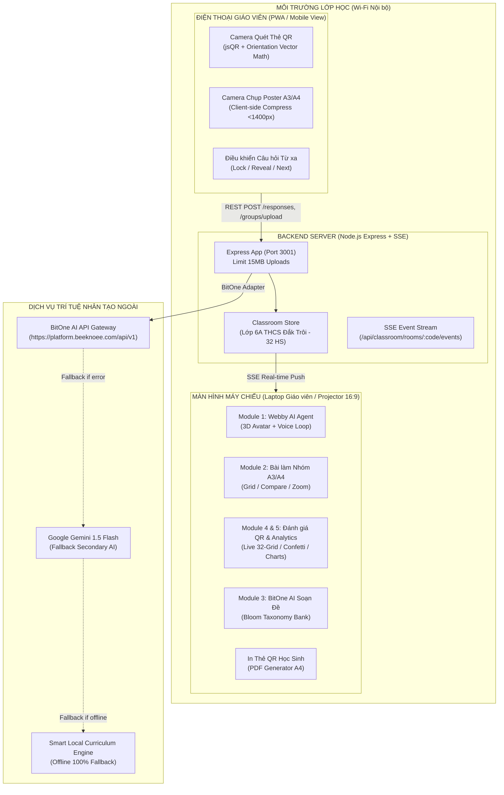

# KIẾN TRÚC TOÀN HỆ THỐNG (ARCHITECTURE.md)
## WEBBY CLASSROOM – AI AGENT & NỀN TẢNG THAO GIẢNG TIN HỌC THCS

---

### 1. SƠ ĐỒ KIẾN TRÚC TỔNG THỂ (SYSTEM ARCHITECTURE)

---

### 2. CƠ CHẾ ĐỒNG BỘ THỜI GIAN THỰC (REAL-TIME ENGINE)

- **Tại sao chọn SSE (Server-Sent Events) kết hợp REST API thay vì WebSocket thuần túy?**
  - Mạng Wi-Fi trong trường học thường xuyên bị chặn các cổng phụ hoặc giao thức WebSocket bị tường lửa trường học ngắt kết nối định kỳ.
  - SSE sử dụng HTTP chuẩn (`text/event-stream`), vượt qua 100% proxy, firewall của nhà trường.
  - Phía điện thoại giáo viên chỉ cần gửi dữ liệu qua các lệnh `POST` đơn giản, nhẹ và bền bỉ khi mạng chập chờn.
  - Máy chiếu duy trì kết nối luồng SSE tại `/api/classroom/rooms/:code/events`, khi có học sinh nộp bài hoặc có ảnh bài làm mới, máy chiếu nhận tín hiệu và cập nhật tức thì trong thời gian < 100ms.

---

### 3. THUẬT TOÁN THỊ GIÁC MÁY TÍNH & TÍNH TOÁN GÓC QUAY THẺ QR (COMPUTER VISION MATH)

Mỗi thẻ QR học sinh được in kèm 4 chữ cái lớn trên 4 mép:
- Mép trên: **A** (Góc $0^\circ$)
- Mép phải: **B** (Góc $90^\circ$)
- Mép dưới: **C** (Góc $180^\circ$)
- Mép trái: **D** (Góc $270^\circ$)

Thư viện `jsQR` cung cấp tọa độ 4 điểm góc của mã QR trong không gian ảnh:
- `topLeftCorner` $(x_1, y_1)$
- `topRightCorner` $(x_2, y_2)$
- `bottomRightCorner` $(x_3, y_3)$
- `bottomLeftCorner` $(x_4, y_4)$

Thuật toán tính vector định hướng cạnh đỉnh của thẻ:
$$\vec{v} = (\Delta x, \Delta y) = (x_2 - x_1, y_2 - y_1)$$

Góc quay định hướng $\theta$ (đơn vị độ) được xác định bằng hàm `atan2`:
$$\theta = \left(\text{atan2}(\Delta y, \Delta x) \times \frac{180}{\pi} + 360\right) \pmod{360}$$

**Quy tắc ánh xạ sang đáp án lựa chọn của học sinh:**
- Nếu $315^\circ \le \theta < 360^\circ$ hoặc $0^\circ \le \theta < 45^\circ \implies$ **Đáp án A** (Mép A hướng lên trên).
- Nếu $45^\circ \le \theta < 135^\circ \implies$ **Đáp án B** (Mép B hướng lên trên).
- Nếu $135^\circ \le \theta < 225^\circ \implies$ **Đáp án C** (Mép C hướng lên trên).
- Nếu $225^\circ \le \theta < 315^\circ \implies$ **Đáp án D** (Mép D hướng lên trên).

Hệ thống vẽ khung nhận diện màu xanh lục lên màn hình camera và hiển thị tên học sinh kèm đáp án vừa quét được, đồng thời kích hoạt rung haptic phản hồi cho giáo viên.

---

### 4. MÔ HÌNH DỮ LIỆU ĐÁNH GIÁ VÀ HỌC SINH (DATA MODEL)

- **Lớp học:** Lớp 6A (THCS Đắk Trôi) – 32 học sinh (Chuẩn sĩ số trường phổ thông vùng DTTS/nông thôn).
- **Mã thẻ:** `CARD_0001` đến `CARD_0032`, tương ứng từ Nguyễn Hoàng An (HS6A01) đến Lê Cẩm Yến (HS6A32).
- **Trạng thái câu hỏi:**
  - `COLLECTING`: Cho phép camera điện thoại quét và nhận diện bài nộp. Màn hình máy chiếu hiển thị danh sách học sinh đã nộp bằng ô sáng màu xanh (nhưng GIẤU đáp án A/B/C/D để chống học sinh nhìn bài nhau).
  - `LOCKED`: Khóa không nhận thêm bài làm từ điện thoại.
  - `REVEALED`: Công bố đáp án, kích hoạt pháo hoa chúc mừng (`canvas-confetti`), hiển thị phân bố tỷ lệ %, bảng câu trả lời cá nhân và nút phân tích sư phạm BitOne AI.

